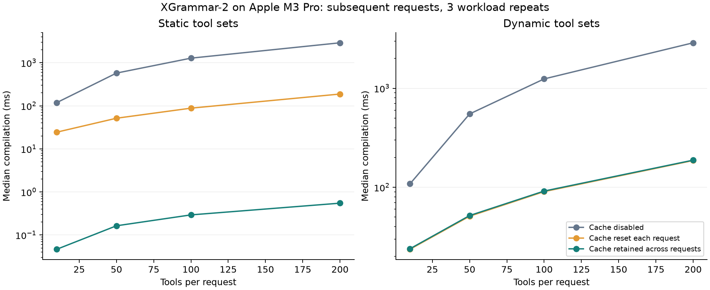
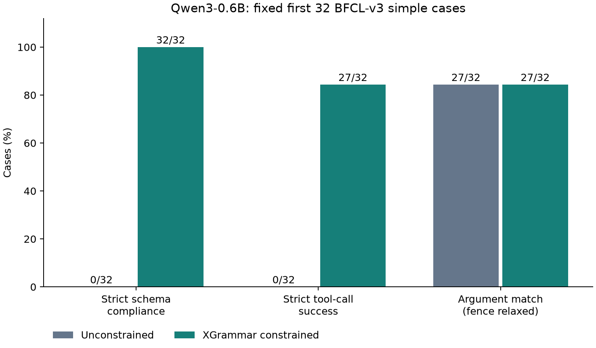

# XGrammar-2 本地核心实验复现

研究对象为 **XGrammar-2: Dynamic and Efficient Structured Generation Engine for Agentic LLMs**（ACM CAIS 2026）。它针对 Agent 频繁更换工具集合时的结构化生成，提出标签触发的语法切换和细粒度缓存复用。本项目使用固定版本的作者库，在 Apple M3 Pro 上测量这些机制，并以真实 Qwen3-0.6B 输出做独立检查。

论文来源：[arXiv v4](https://arxiv.org/abs/2601.04426v4)、[正式 DOI](https://doi.org/10.1145/3786335.3813124)；[作者仓库](https://github.com/mlc-ai/xgrammar)、[作者发布说明](https://blog.mlc.ai/2026/05/04/xgrammar-2-fast-customizable-structured-generation)。本项目是独立复现，未声称获得作者认可，也不是新的论文发表或官方 BFCL 排行榜提交。

## 对应论文的实验范围

| 原文 | 本项目 | 与原实验的差异 |
|---|---|---|
| §4.1 动态/静态工具集合、跨语法复用 | BFCL v3 的真实工具参数；10/50/100/200 个工具；每组 20 请求、3 次独立随机工作负载 | 原文包含 500 工具规模，本项目池只有 370 个工具名；测量本机单线程 CPU，不要求绝对耗时等于论文 |
| 标签触发的结构化生成 | 使用官方 `triggered_tags` / TagDispatch 表示；有效和无效序列及 CPU bitmask 核验 | 固定小型正确性夹具，未跑全 CONFETTI 数据或标签数量 Table 2 |
| §4.3 的模型/数据设置与附录 I 的结构正确性 | 前 32 道 simple 题，贪心生成，固定输入，逐题有无 JSON Schema 约束配对 | 使用 Hugging Face + Metal；自定义 JSON 调用格式和严格参考值评分；未使用 SGLang 原服务流程，未跑全 BFCL |

固定作者库为首次 XGrammar-2 正式发布 **v0.2.0**，源码提交 `5433fdbea7003eea61cb863768a05fb8da3bf919`。该版本早于 arXiv v4 的最终修订；本项目验证已发布实现的上述核心机制，不推断后来修订的全部优化都存在于此版本。

原论文 §4.1 的性能比较包含旧 XGrammar v0.1.19 和新引擎；本项目三组对照均使用 v0.2.0，属于同版本缓存生命周期消融，不能当作论文新旧引擎速度比的直接复现。固定版本源码的 `MultiThreadCompileGrammar` 预计算 reachable 状态的 mask，本项目未验证 §3.5 的 JIT 优化，也不使用 JIT 来解释测量结果。

模型为 `Qwen/Qwen3-0.6B`，固定提交 `c1899de289a04d12100db370d81485cdf75e47ca`。数据取自 Gorilla 作者仓库固定 BFCL v3 历史提交 `cd9429ccf3d4d04156affe883c495b3b047e6b64`；当前主分支已更新为 v4，所以没有直接下载最新分支。源码、模型文件和数据的 SHA-256 分别见 `source_manifest.json`、`model_manifest.json`、`inputs/data_provenance.json`。

## 实验与指标

缓存实验保留 399 个不同的 `name+parameters` 工具身份、370 个名称及同名不同参数的变体。每次请求内名称不重复；动态条件中完整 grammar 哈希从不重复；静态条件刻意重复同一个 grammar。三组输入完全相同，六种执行顺序交替，编译器单线程。计时仅包含 `compile_structural_tag`，不包含 compiler 构造、准备输入和读取缓存大小；首次冷请求与后续请求分开统计。

- `disabled`：关闭缓存，包括请求内和跨请求复用。
- `persistent`：请求内缓存和跨请求缓存均保留。
- `reset_each_request`：每请求新建开启缓存的 compiler，保留请求内复用，排除跨请求复用。

`reset_each_request / persistent` 才用于分析跨请求缓存对编译耗时的增益；`disabled / persistent` 同时包含请求内复用差异，不能将全部比率归因于跨请求缓存。仅有三次工作负载重复，bootstrap 区间描述本次测量的不确定性，不能代表充分的跨机器或大样本统计证据。缓存计数来自作者 API，不是实际进程 RSS。

模型实验在运行前固定源顺序 `simple_0..simple_31`，不按生成结果筛选。两种模式使用相同模板、关闭 thinking、贪心解码、最多 192 个新 token，交替模式顺序。完整输出必须以 EOS 结束才计入成功。参数评分允许参考候选中的数值等价，递归区分布尔值与数值；字符串严格匹配，不使用官方 BFCL 的大小写、标点或代数化简规则。

- `schema_valid`：原始完整文本严格 JSON 解析，并通过 JSON Schema。拒绝重复键、NaN、Infinity 和数字溢出。完成情况另行报告。
- `argument_exact`：完成生成、严格格式合规，且所有参数符合参考候选；这是端到端严格工具调用成功。
- `content_argument_exact`：补充语义诊断，仅允许去除整个输出外的一对 Markdown JSON 围栏，然后检查参数。不计为严格格式合规，也不是官方 BFCL 分数。

格式约束不会保证参数在语义上正确。Supplementary 指标使读者可以区分“修正 Markdown 包装”和“更正确地选择参数”。仅输出函数名和参数进行检查；不执行模型生成的函数、命令或代码。

官方 v0.2.0 HF adapter 将 torch scalar 直接传给 matcher；当前 TVM FFI 不接受该类型，MPS scalar 还缺少 native stream handle。本项目保留官方首次初始化，后续单样本步骤将 token 转为 Python `int`，仍使用作者 matcher、CPU mask 和回传 MPS 的 logits。该兼容调整记录在 `generation_summary.json`；逐 token bitmask 重放由独立验证器确认。

## 运行

已验证的计算环境为 CPython 3.12.2 ARM64、独立虚拟环境，CPU 基准使用单线程，模型使用 Metal FP16。已有 Anaconda Jupyter 用于显示与执行入口，实际计算由项目 Python 3.12 子进程完成。全局 Anaconda 未改动。包版本全部固定在 `requirements.txt`，硬件记录见 `hardware.json`。

```bash
python3.12 -m venv .venv
source .venv/bin/activate
python -m pip install --only-binary=:all: -r requirements.txt
python setup_sources.py
python download_model.py
python setup_sources.py --verify-only
python run_notebook.py
python validate_replication.py --notebook xgrammar2_reproduction.ipynb
```

首次准备需要网络，之后离线运行。下载器只读取公开固定文件，不使用账户 token，不执行 remote model code。权重约 1.5 GB，环境及缓存还需数 GB；18 GB RAM 的 Mac 可运行本次规模。没有 Metal 的机器默认改用 CPU，速度和生成数值可能不同；论文服务器吞吐不能由这里的测量推出。

也可以直接在 Jupyter 打开 `xgrammar2_reproduction.ipynb` 并执行全部单元格。命令行单独运行同一实验：

```bash
python benchmark_runner.py --counts 10,50,100,200 --requests 20 --repeats 3 --tokenizer models/Qwen3-0.6B --local-files-only
python generation_runner.py --count 32 --max-new-tokens 192
python validate_replication.py
python plot_results.py
python repeat_generation.py
```

## 独立验证与公开文件

验证器不导入两个运行器的转换或评分函数，独立从原始固定数据构造 schema、检查答案和指标。它检查来源与全部模型文件哈希、完整 32 题配对、prompt/token 哈希、EOS 和截断、每步 mask/accept 一致性、三组缓存输入和工作负载覆盖、冷/热划分、计时汇总和 bootstrap 复算。缺少文件或只运行 smoke 会失败；检查通过不代表每个模型答案都正确，也不代表本机必然观察到论文全部性能增益。

公开仓库仅包含原创运行器、下载/验证工具、文档、来源元数据、生成结果及测量表和图。模型权重、原 BFCL 数据、作者源码及 ZIP、虚拟环境和 smoke 结果不上传。第三方内容保留原始许可；本项目 MIT 仅覆盖原创代码与文档。引用说明见 `CITATION.cff`。





## 本次结果

完成 **1,440 次编译测量**、32 题的 **64 次真实模型生成**，各项来源、输入、评分与 mask 重放检查通过。Notebook 保留完整执行日志和图表；具体检查数量和 Notebook 执行核验以 `results/validation_report.json` 为准。

| 模式 | 完成生成 | 严格 Schema 合规 | 严格工具调用成功 | 去除整段 Markdown 围栏后参数正确 |
|---|---:|---:|---:|---:|
| 无约束 | 32/32 | 0/32 | 0/32 | 27/32 |
| XGrammar 约束 | 32/32 | 32/32 | 27/32 | 27/32 |

无约束模式的全部 32 个输出都带 Markdown 围栏，约束模式没有围栏。本次主要改进是输出能被严格 JSON 工具直接消费；**未观察到参数内容正确率的改善**。两种模式的错误题相同：`simple_5, simple_13, simple_14, simple_15, simple_16`。32 个固定简单任务不能代表一般 Agent 能力。

| 动态工具数 | 总缓存对照 disabled/persistent | 跨请求对照 reset/persistent |
|---:|---:|---:|
| 10 | 4.39× | 0.993× |
| 50 | 10.43× | 0.982× |
| 100 | 13.53× | 0.988× |
| 200 | 15.31× | 0.993× |

比率为三次重复中后续请求平均耗时之比的均值。小于 1 表示 persistent 更慢。本机动态条件下，**未观察到额外的跨请求编译加速**，而不是复现出原论文全部加速主张。静态完整 grammar 的热缓存对照约为 294–484×。总体缓存收益包括请求内重复子结构复用；没有阶段 profile 或 cache hit/miss 计数，不能确定额外耗时的具体原因，也不能宣称 runtime 改善或内存节省。

模型已完成第二次独立进程重复运行，64 条记录的输出、tokens、评分及输入哈希全部一致；逐项比较记录在 `results/reproducibility_report.json`；它不把浮动计时要求为相同，也不代表跨机器或不同精度环境下的输出保证。原实验和重复实验都由同一独立验证器从原数据检查。
